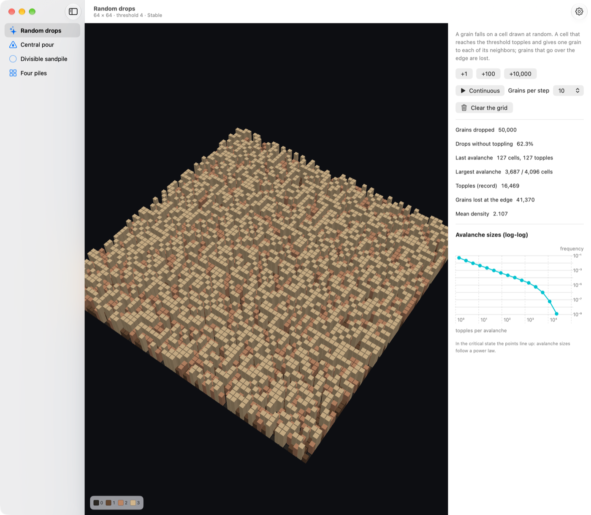
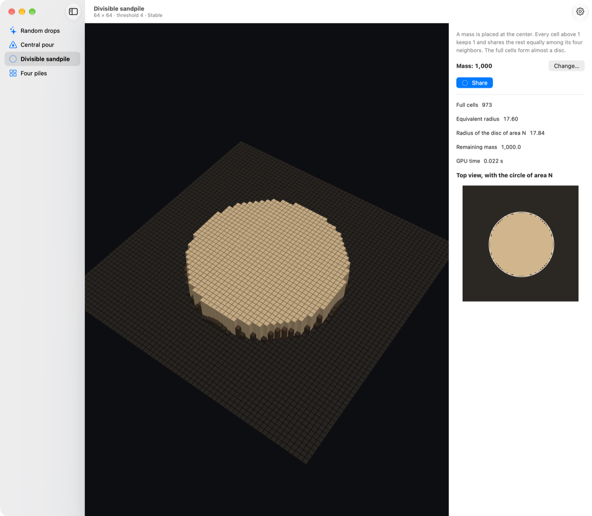
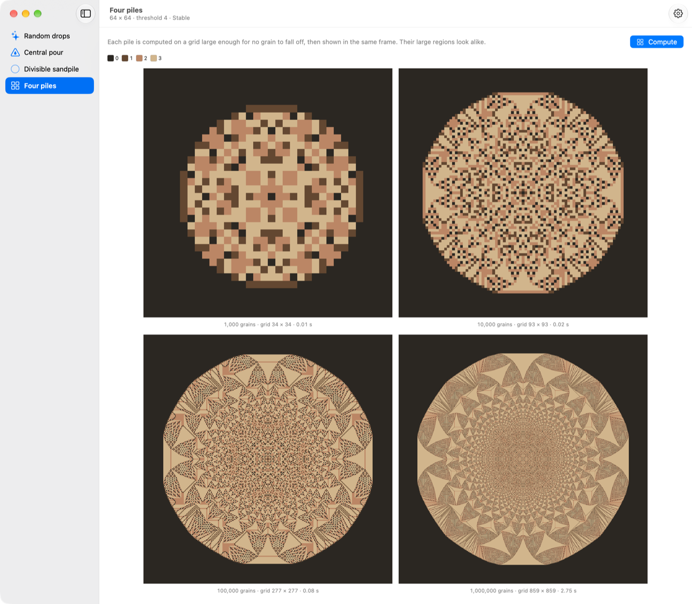
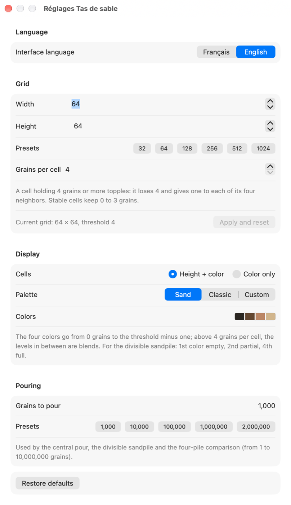

# TasDeSable

*Version française : [README_fr.md](README_fr.md)*

A sandpile simulator for macOS, written in **Swift 6**, **SwiftUI** and **Metal**. The grid is
rendered in 3D: each cell is a column whose height and color show how many grains it holds.



## The model

On a 64 × 64 grid, a cell holding four grains or more **topples** and gives one grain to each of
its four neighbors, which may topple in turn. Grains that go over the edge are lost, so every
cascade eventually stops. In our runs, more than half of the drops do nothing (about 62%), and then
a single grain makes up to 3,500 of the 4,096 cells topple.

This is the model of Per Bak, Chao Tang and Kurt Wiesenfeld (1987). With open edges and grains
added slowly, the grid settles by itself into a state where one grain can set off an avalanche that
sweeps across it, or do nothing at all: **self-organized criticality**. In Oslo, in 1996,
elongated rice grains produced avalanches of every size, which was no longer the case with less
elongated rice.

Grains poured at the center of an empty grid draw triangles. On a finite grid with open edges, with
the same grains in the same places, the order of the topplings does not change the picture: the
model is **abelian**. If the grains are shared instead of kept whole, the rule changes and the full
cells form almost a disc. In 2013, Wesley Pegden and Charles Smart proved that, for this central
pour, there is a limit shape, valid on average over small regions.

## The four experiments

| Experiment | What it shows | Computed on |
|---|---|---|
| **Random drops** | Grains dropped one at a time at random (+1, +100, +10,000 or continuously). Share of drops without toppling, record avalanches, log-log histogram of their sizes. | CPU, exact grain by grain |
| **Central pour** | N grains placed at the center, fractal patterns. In the background, the same grains are poured one at a time on the CPU to get the log-log histogram of their avalanches; the resulting grid is compared with the GPU one. **Check** button: the same grains stabilized as a queue, in random order and in parallel, giving three identical grids, cell by cell. | GPU (Metal compute) and CPU |
| **Divisible sandpile** | The mass is shared instead of staying in whole grains: the full cells almost fill the disc of area N. | GPU |
| **Four piles** | N, 10 N, 100 N and 1,000 N grains, each on a grid large enough to lose nothing, shown in the same frame. | GPU |

| Central pour | Divisible sandpile |
|---|---|
|  |  |



Both histograms are log-log plots of avalanche sizes (number of topplings), with both axes labeled
in powers of ten (10⁰, 10¹… and 10⁻¹, 10⁻²…). In the critical state the points line up: avalanche
sizes follow a power law, cut off by the finite size of the grid.

## Settings

**TasDeSable › Settings…** menu (⌘,) or the gear button in the toolbar.

| Setting | Range | Default | Effect |
|---|---|---|---|
| Grid size (width × height) | 8 to 1,024 per side | 512 × 512 | Applied with **Apply and reset** (asks for confirmation if there are results) |
| Grains per cell (threshold T) | 4 to 10 | 4 | Same |
| Language | Français, English | System language (English if it comes first, French otherwise) | Immediate, without restarting the app |
| Display | Height + color, or color only | Height + color | Immediate; color only switches to a top view |
| Palette | Sand, Classic, Custom | Sand | Immediate; the custom palette has 4 color pickers |
| Grains to pour | 1 to 10,000,000 | 1,000,000 | Immediate; used by the central pour, the divisible sandpile and the four piles |

**Rule with a threshold T**: a cell holding T grains or more topples, loses 4 grains and gives one
to each of its four neighbors. For T = 4 this is the Bak–Tang–Wiesenfeld model; for T > 4, stable
cells keep up to T − 1 grains and the model stays abelian. The minimum of 4 guarantees that a
toppling never creates grains.

**Palettes**: each has four colors, from 0 to 3 grains. For a threshold T > 4, the levels in
between are blends. In the divisible sandpile, the 1st color marks an empty cell, a blend of the
1st and 2nd a partly filled cell, and the 4th a full cell.

| Palette | 0 | 1 | 2 | 3 |
|---|---|---|---|---|
| Sand | `#2B2722` | `#634731` | `#BB8665` | `#D1B58C` |
| Classic | `#1A295A` | `#1A8C99` | `#F2C740` | `#D94033` |
| Custom | your choice | your choice | your choice | your choice |

**Language**: every text of the app lives in a string catalog
(`TasDeSable/Localizable.xcstrings`). French is the source language and English the translation.
Numbers follow the chosen language: "1,000" or "1 000". Only the menus provided by macOS and the
title of the settings window follow the system language.



In the 3D view, **drag** to orbit the camera, **scroll** or **pinch** to zoom, and **double-click**
to return to the default view. Closing the last window quits the app.

## Build and run

Requirements: macOS 15 or later, Xcode 16 or later with the **Metal Toolchain**, and
[XcodeGen](https://github.com/yonaskolb/XcodeGen) (`brew install xcodegen`).

```bash
xcodegen generate                                   # creates TasDeSable.xcodeproj from project.yml
open TasDeSable.xcodeproj                           # then ⌘R in Xcode
```

From the command line:

```bash
# If xcode-select points to the Command Line Tools, use Xcode without changing anything:
export DEVELOPER_DIR=/Applications/Xcode.app/Contents/Developer
xcodebuild -downloadComponent MetalToolchain        # once, if the metal compiler is missing
xcodebuild -project TasDeSable.xcodeproj -scheme TasDeSable -derivedDataPath build build
open build/Build/Products/Debug/TasDeSable.app
```

Start an experiment directly (handy for testing and screenshots); settings can be overridden the
same way, for this launch only:

```bash
open build/Build/Products/Debug/TasDeSable.app --args -demo comparison   # randomDrop | centralPour | divisible | comparison
open build/Build/Products/Debug/TasDeSable.app --args -demo randomDrop -grid.width 64 -grid.height 64 -app.language en
```

## Tests

```bash
xcodebuild -project TasDeSable.xcodeproj -scheme TasDeSable -derivedDataPath build test
```

30 tests (Swift Testing), covering:
- a single toppling and loss at the edge, conservation of grains, stability;
- more than half of the drops doing nothing in the critical state;
- the abelian property: queue = stack = random order, CPU = GPU for 10⁴ and 10⁶ grains, threshold
  7, grain-by-grain pour at the center = pouring all at once;
- merging statistics computed in batches;
- axis labels in powers of ten;
- the divisible sandpile: mass conserved, disc of area N;
- the size of the comparison grids;
- settings: defaults, bounds, persistence of language and palette;
- the English translation;
- palettes: 4 levels = 4 colors, hexadecimal conversion;
- the simulation model: every experiment run to completion (drops, continuous drops, central pour
  and its grain-by-grain computation, stopping that computation, abelian check, divisible sandpile,
  four piles), applying settings, the `-demo` argument;
- the views: every screen built in French and in English, empty and then with results.

### Code coverage

```bash
scripts/coverage.sh            # tests + per-file coverage report
scripts/coverage.sh --json     # also keeps the full report in build/coverage.json
```

The script turns coverage on (`-enableCodeCoverage YES`, and `gatherCoverageData` in the
`project.yml` scheme), runs the tests, then prints the `xccov` report for the app. The raw result,
`build/coverage.xcresult`, opens in Xcode (*Coverage* tab); coverage also shows up after ⌘U in
Xcode.

Current coverage: **92.5%** of the app's lines (2,673 / 2,890). The model, the CPU and GPU
engines, the statistics, the palette and the views are all above 90%. What is left: the delegate
that quits the app when the last window closes, and mouse gestures on the 3D view, which need
real events.

## Project layout

```
project.yml                 XcodeGen spec (macOS 15 target, Swift 6, strict concurrency)
TasDeSable/
  App/                      SwiftUI entry point
  Settings/                 AppSettings (UserDefaults) and the settings page
  Model/                    Grid, CPUSandpile, GPUSandpile, AvalancheStats, SimulationModel
  Metal/                    Sandpile.metal (compute), Render.metal (rendering), SandpileRenderer, MetalView
  Views/                    main window, panels, histogram, palette
  Localizable.xcstrings     interface texts (French source, English)
TasDeSableTests/            Swift Testing tests
scripts/coverage.sh         tests with code coverage
docs/architecture.md        technical documentation (in French)
docs/uml/                   StarUML model (tasdesable.mdj) and diagram images
```

The technical documentation (algorithms, Metal kernels, concurrency, UML model) is in
[docs/architecture.md](docs/architecture.md), in French.

## Sources

- P. Bak, C. Tang and K. Wiesenfeld, *Self-organized criticality: An explanation of the 1/f noise*,
  Phys. Rev. Lett. **59**, 381 (1987).
- V. Frette, K. Christensen, A. Malthe-Sørenssen, J. Feder, T. Jøssang and P. Meakin,
  *Avalanche dynamics in a pile of rice*, Nature **379**, 49 (1996).
- W. Pegden and C. K. Smart, *Convergence of the Abelian sandpile*, Duke Math. J. **162**, 627 (2013),
  [arXiv:1105.0111](https://arxiv.org/abs/1105.0111).
- L. Levine and Y. Peres, *Strong spherical asymptotics for rotor-router aggregation and the
  divisible sandpile*, [arXiv:0704.0688](https://arxiv.org/abs/0704.0688); and L. Levine and
  Y. Peres, *Laplacian growth, sandpiles, and scaling limits*, Bull. AMS **54**, 355 (2017).
- L. Levine, W. Pegden and C. K. Smart, *Apollonian structure in the Abelian sandpile*,
  GAFA **26**, 306 (2016).
