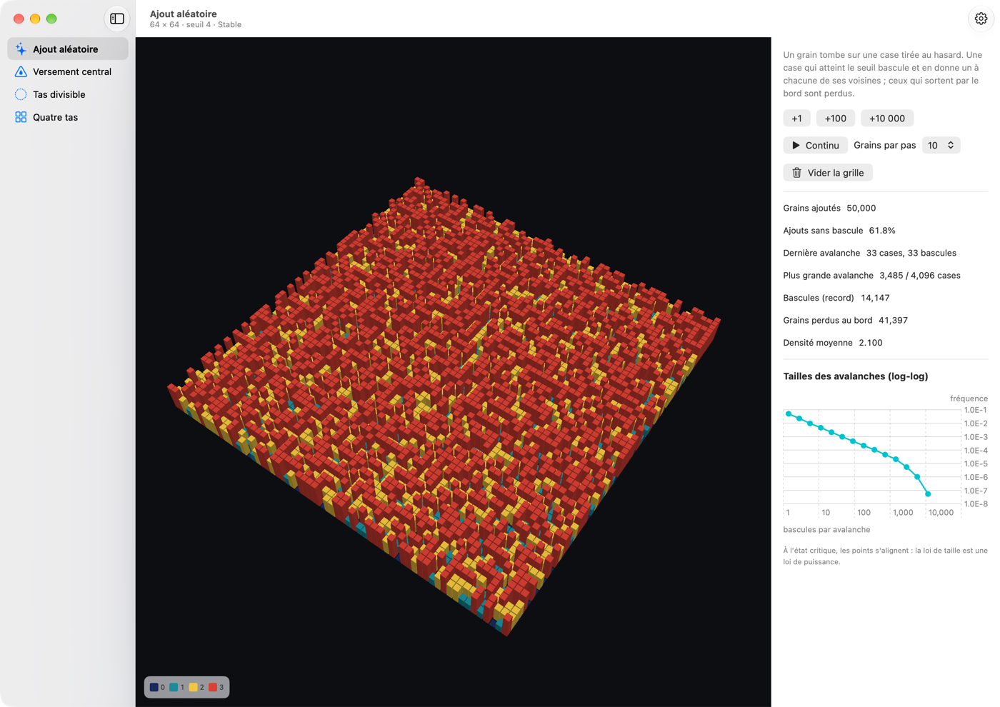
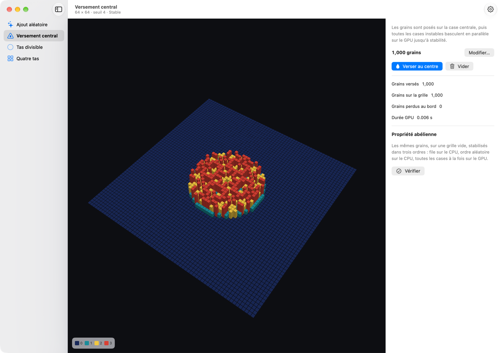
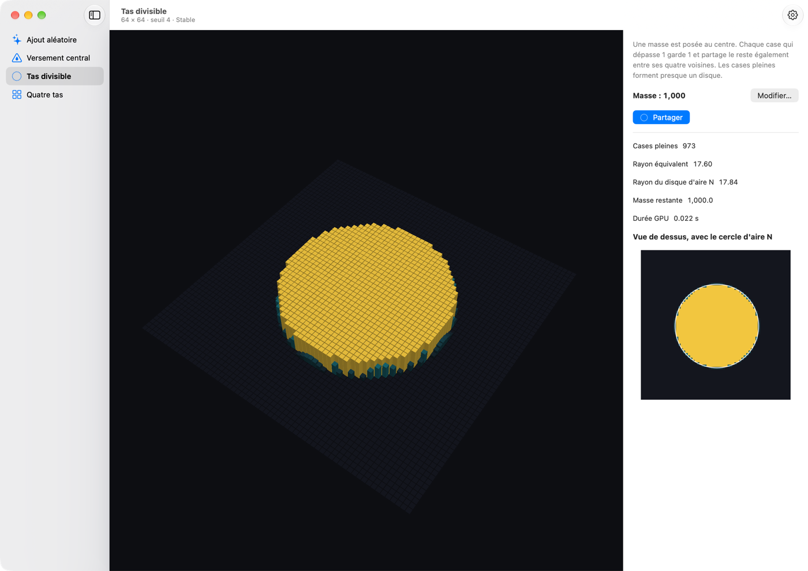

# TasDeSable

Simulateur de tas de sable pour macOS, en **Swift 6**, **SwiftUI** et **Metal**. La grille est
rendue en 3D : chaque case est une colonne dont la hauteur et la couleur disent combien de grains
elle porte.



## Le modèle

Sur une grille de 64 × 64 cases, une case qui porte quatre grains ou plus **bascule** et en donne
un à chacune de ses quatre voisines, qui peuvent basculer à leur tour. Les grains qui sortent par le
bord sont perdus, donc toute cascade finit par s'arrêter. Dans nos essais, plus d'un ajout sur deux
ne fait rien (environ 62 %), puis un seul grain fait basculer jusqu'à 3 500 des 4 096 cases.

C'est le modèle de Per Bak, Chao Tang et Kurt Wiesenfeld (1987). Avec des bords ouverts et des
grains ajoutés lentement, la grille se place d'elle-même dans un état où un grain peut déclencher
une avalanche qui la traverse, ou ne rien faire du tout : la **criticalité auto-organisée**. À Oslo,
en 1996, du riz à grains allongés a donné des avalanches de toutes les tailles, ce qui n'était plus
le cas avec du riz moins allongé.

Des grains versés au milieu d'une grille vide dessinent des triangles. Sur une grille finie aux
bords ouverts, avec les mêmes grains aux mêmes endroits, l'ordre des bascules ne change pas ce
dessin : le modèle est **abélien**. Si l'on partage les grains au lieu de les garder entiers, la
règle change et les cases pleines forment presque un disque. En 2013, Wesley Pegden et Charles Smart
ont démontré qu'il existe, pour ce versement central, une forme limite, valable en moyenne par
petites zones.

## Les quatre expériences

| Expérience | Ce qu'elle montre | Calcul |
|---|---|---|
| **Ajout aléatoire** | Grains ajoutés un à un au hasard (+1, +100, +10 000 ou en continu). Part des ajouts sans effet, avalanches record, histogramme log-log des tailles. | CPU, exact grain par grain |
| **Versement central** | N grains posés au centre, motifs fractals. Bouton **Vérifier** : mêmes grains stabilisés en file, en ordre aléatoire et en parallèle, trois résultats identiques case par case. | GPU (Metal compute) et CPU |
| **Tas divisible** | La masse est partagée au lieu de rester en grains : les cases pleines forment presque le disque d'aire N. | GPU |
| **Quatre tas** | N, 10 N, 100 N et 1 000 N grains, chacun sur une grille assez grande pour ne rien perdre, affichés dans le même cadre. | GPU |

| Versement central | Tas divisible |
|---|---|
|  |  |


## Réglages

Menu **TasDeSable › Réglages…** (⌘,) ou bouton engrenage de la barre d'outils.

| Réglage | Plage | Défaut | Effet |
|---|---|---|---|
| Taille de la grille (largeur × hauteur) | 8 à 1 024 par côté | 64 × 64 | Appliquée avec **Appliquer et réinitialiser** (confirmation si des résultats existent) |
| Grains par case (seuil T) | 4 à 10 | 4 | Idem |
| Affichage | Hauteur + couleur, ou couleur seule | Hauteur + couleur | Immédiat ; la couleur seule passe en vue de dessus |
| Grains à déverser | 1 à 10 000 000 | 1 000 | Immédiat ; utilisé par le versement central, le tas divisible et les quatre tas |

**Règle avec un seuil T** : une case qui porte T grains ou plus bascule, perd 4 grains et en donne
un à chacune de ses quatre voisines. Pour T = 4, c'est le modèle de Bak, Tang et Wiesenfeld ; pour
T > 4, les cases stables gardent jusqu'à T − 1 grains et le modèle reste abélien. Le minimum de 4
garantit qu'une bascule ne crée pas de grains.


Dans la vue 3D, **glisser** fait tourner la caméra, la **molette** ou le **pincement** zoome, et le
**double-clic** revient à la vue par défaut.

## Compiler et lancer

Prérequis : macOS 15 ou plus récent, Xcode 16 ou plus récent avec la **Metal Toolchain**, et
[XcodeGen](https://github.com/yonaskolb/XcodeGen) (`brew install xcodegen`).

```bash
xcodegen generate                                   # crée TasDeSable.xcodeproj depuis project.yml
open TasDeSable.xcodeproj                           # puis ⌘R dans Xcode
```

En ligne de commande :

```bash
# Si xcode-select pointe sur les Command Line Tools, utiliser Xcode sans rien changer :
export DEVELOPER_DIR=/Applications/Xcode.app/Contents/Developer
xcodebuild -downloadComponent MetalToolchain        # une seule fois, si le compilateur metal manque
xcodebuild -project TasDeSable.xcodeproj -scheme TasDeSable -derivedDataPath build build
open build/Build/Products/Debug/TasDeSable.app
```

Lancement direct d'une expérience (pratique pour les essais et les captures) :

```bash
open build/Build/Products/Debug/TasDeSable.app --args -demo comparison   # randomDrop | centralPour | divisible | comparison
```

## Tests

```bash
xcodebuild -project TasDeSable.xcodeproj -scheme TasDeSable -derivedDataPath build test
```

13 tests (Swift Testing) : bascule simple et perte au bord, conservation des grains, stabilité,
plus d'un ajout sur deux sans effet à l'état critique, abélianité (file = pile = aléatoire, CPU = GPU
pour 10⁴ et 10⁶ grains, seuil 7), tas divisible (masse conservée, disque d'aire N), dimension des
grilles de comparaison, réglages (valeurs par défaut, bornes, persistance).

## Organisation

```
project.yml                 spécification XcodeGen (cible macOS 15, Swift 6, concurrence stricte)
TasDeSable/
  App/                      point d'entrée SwiftUI
  Settings/                 AppSettings (UserDefaults) et page de réglages
  Model/                    Grid, CPUSandpile, GPUSandpile, AvalancheStats, SimulationModel
  Metal/                    Sandpile.metal (calcul), Render.metal (rendu), SandpileRenderer, MetalView
  Views/                    fenêtre principale, panneaux, palette
TasDeSableTests/            tests Swift Testing
docs/architecture.md        documentation technique
docs/uml/                   modèle StarUML (tasdesable.mdj) et images des diagrammes
```

La documentation technique, avec les algorithmes, les kernels Metal, la concurrence et le modèle
UML, est dans [docs/architecture.md](docs/architecture.md).

## Sources

- P. Bak, C. Tang et K. Wiesenfeld, *Self-organized criticality: An explanation of the 1/f noise*,
  Phys. Rev. Lett. **59**, 381 (1987).
- V. Frette, K. Christensen, A. Malthe-Sørenssen, J. Feder, T. Jøssang et P. Meakin,
  *Avalanche dynamics in a pile of rice*, Nature **379**, 49 (1996).
- W. Pegden et C. K. Smart, *Convergence of the Abelian sandpile*, Duke Math. J. **162**, 627 (2013),
  [arXiv:1105.0111](https://arxiv.org/abs/1105.0111).
- L. Levine et Y. Peres, *Strong spherical asymptotics for rotor-router aggregation and the divisible
  sandpile*, [arXiv:0704.0688](https://arxiv.org/abs/0704.0688) ; et L. Levine et Y. Peres,
  *Laplacian growth, sandpiles, and scaling limits*, Bull. AMS **54**, 355 (2017).
- L. Levine, W. Pegden et C. K. Smart, *Apollonian structure in the Abelian sandpile*,
  GAFA **26**, 306 (2016).
