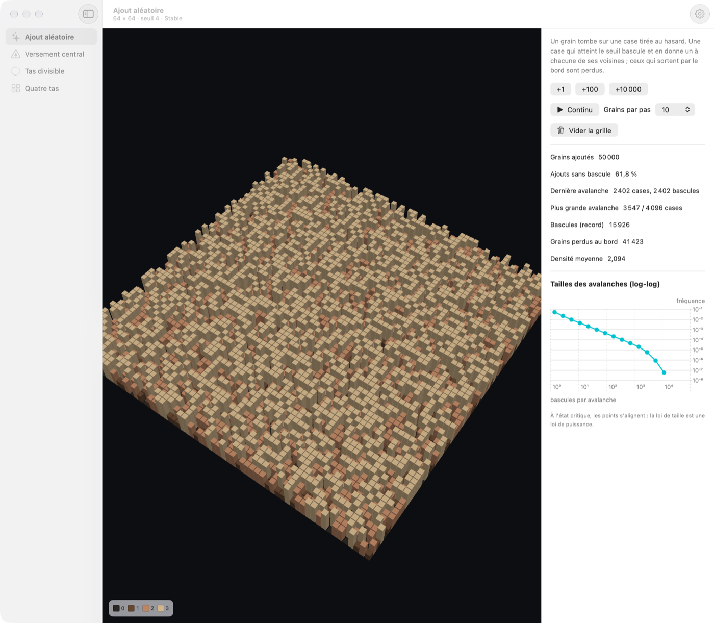
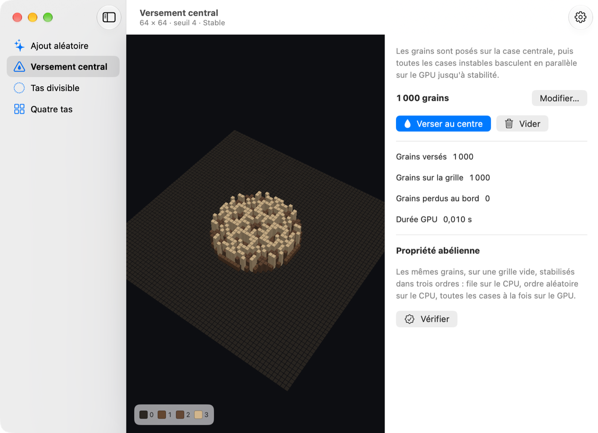
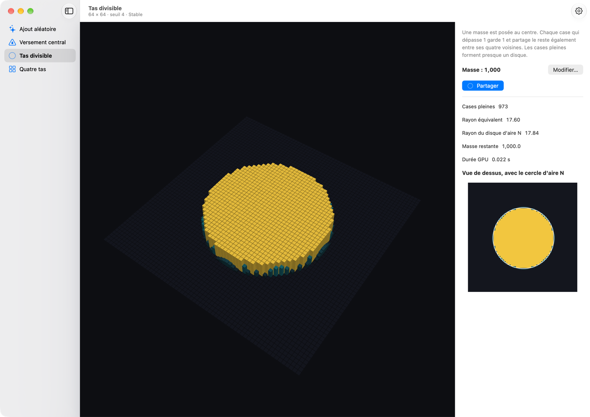
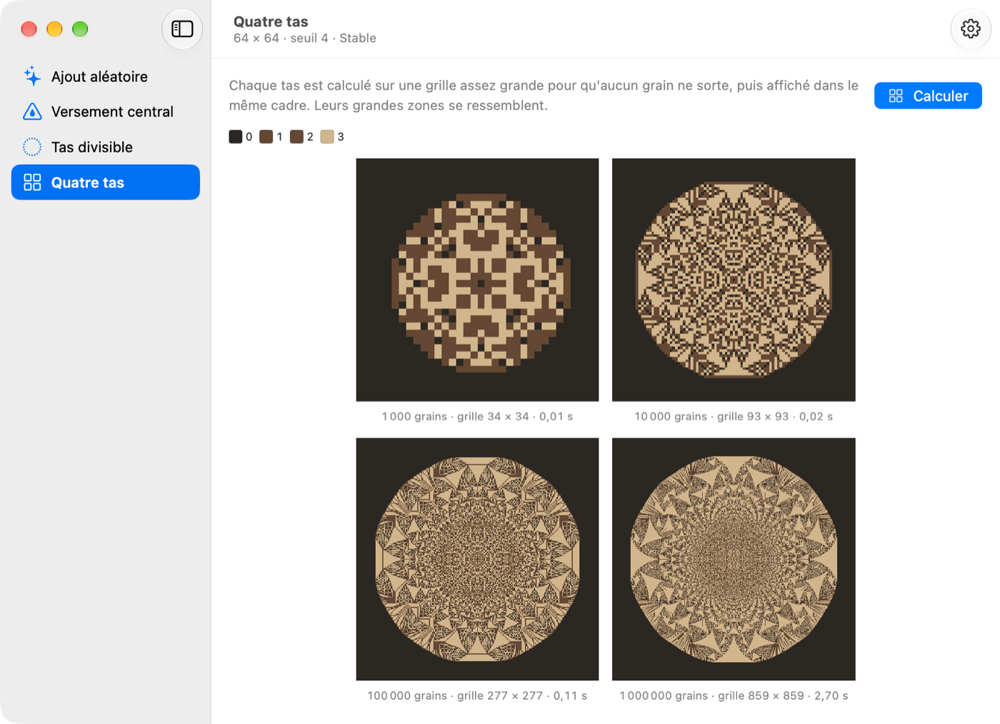
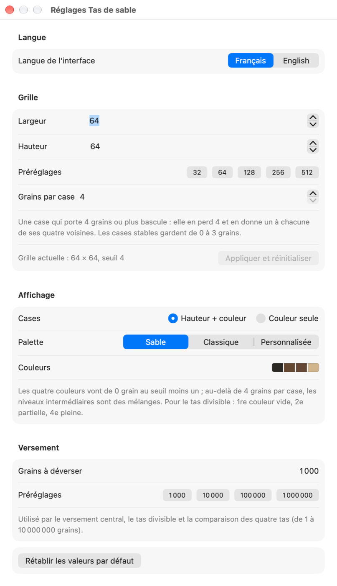

# TasDeSable

*English version: [README.md](README.md)*

Simulateur de tas de sable pour macOS, en **Swift 6**, **SwiftUI** et **Metal**. La grille est
rendue en 3D : chaque case est une colonne dont la hauteur et la couleur disent combien de grains
elle porte.



## Le modèle

Sur une grille de 64 × 64 cases, une case qui porte quatre grains ou plus **bascule** et en donne
un à chacune de ses quatre voisines, qui peuvent basculer à leur tour. Les grains qui sortent par le
bord sont perdus, donc toute cascade finit par s'arrêter. Dans nos essais, plus d'un ajout sur deux
ne fait rien (environ 62 %), puis un seul grain fait basculer jusqu'à 3 500 des 4 096 cases.

C'est le modèle de Per Bak, Chao Tang et Kurt Wiesenfeld (1987). Avec des bords ouverts et des
grains ajoutés lentement, la grille se place d'elle-même dans un état où un grain peut déclencher
une avalanche qui la traverse, ou ne rien faire du tout : la **criticalité auto-organisée**. À Oslo,
en 1996, du riz à grains allongés a donné des avalanches de toutes les tailles, ce qui n'était plus
le cas avec du riz moins allongé.

Des grains versés au milieu d'une grille vide dessinent des triangles. Sur une grille finie aux
bords ouverts, avec les mêmes grains aux mêmes endroits, l'ordre des bascules ne change pas ce
dessin : le modèle est **abélien**. Si l'on partage les grains au lieu de les garder entiers, la
règle change et les cases pleines forment presque un disque. En 2013, Wesley Pegden et Charles Smart
ont démontré qu'il existe, pour ce versement central, une forme limite, valable en moyenne par
petites zones.

## Les quatre expériences

| Expérience | Ce qu'elle montre | Calcul |
|---|---|---|
| **Ajout aléatoire** | Grains ajoutés un à un au hasard (+1, +100, +10 000 ou en continu). Part des ajouts sans effet, avalanches record, histogramme log-log des tailles. | CPU, exact grain par grain |
| **Versement central** | N grains posés au centre, motifs fractals. En arrière-plan, les mêmes grains sont versés un par un sur le CPU pour obtenir l'histogramme log-log de leurs avalanches ; la grille obtenue est comparée à celle du GPU. Bouton **Vérifier** : mêmes grains stabilisés en file, en ordre aléatoire et en parallèle, trois résultats identiques case par case. | GPU (Metal compute) et CPU |
| **Tas divisible** | La masse est partagée au lieu de rester en grains : les cases pleines forment presque le disque d'aire N. | GPU |
| **Quatre tas** | N, 10 N, 100 N et 1 000 N grains, chacun sur une grille assez grande pour ne rien perdre, affichés dans le même cadre. | GPU |

| Versement central | Tas divisible |
|---|---|
|  |  |



## Réglages

Menu **TasDeSable › Réglages…** (⌘,) ou bouton engrenage de la barre d'outils.

| Réglage | Plage | Défaut | Effet |
|---|---|---|---|
| Taille de la grille (largeur × hauteur) | 8 à 1 024 par côté | 512 × 512 | Appliquée avec **Appliquer et réinitialiser** (confirmation si des résultats existent) |
| Grains par case (seuil T) | 4 à 10 | 4 | Idem |
| Langue | Français, English | Langue du système (anglais si c'est la première langue, sinon français) | Immédiat, sans relancer l'application |
| Affichage | Hauteur + couleur, ou couleur seule | Hauteur + couleur | Immédiat ; la couleur seule passe en vue de dessus |
| Palette | Sable, Classique, Personnalisée | Sable | Immédiat ; la palette personnalisée a 4 sélecteurs de couleur |
| Grains à déverser | 1 à 10 000 000 | 1 000 000 | Immédiat ; utilisé par le versement central, le tas divisible et les quatre tas |

**Règle avec un seuil T** : une case qui porte T grains ou plus bascule, perd 4 grains et en donne
un à chacune de ses quatre voisines. Pour T = 4, c'est le modèle de Bak, Tang et Wiesenfeld ; pour
T > 4, les cases stables gardent jusqu'à T − 1 grains et le modèle reste abélien. Le minimum de 4
garantit qu'une bascule ne crée pas de grains.

**Palettes** : chacune a quatre couleurs, de 0 grain à 3 grains. Pour un seuil T > 4, les niveaux
intermédiaires sont des mélanges. Dans le tas divisible, la 1re couleur marque une case vide, un
mélange de la 1re et de la 2e une case partielle, et la 4e une case pleine.

| Palette | 0 | 1 | 2 | 3 |
|---|---|---|---|---|
| Sable | `#2B2722` | `#634731` | `#BB8665` | `#D1B58C` |
| Classique | `#1A295A` | `#1A8C99` | `#F2C740` | `#D94033` |
| Personnalisée | au choix | au choix | au choix | au choix |

**Langue** : tous les textes de l'application sont dans un catalogue de chaînes
(`TasDeSable/Localizable.xcstrings`). Le français est la langue source, l'anglais la traduction.
Les nombres suivent la langue choisie : « 1 000 » ou « 1,000 ». Seuls les menus fournis par macOS
et le titre de la fenêtre de réglages suivent la langue du système.



Dans la vue 3D, **glisser** fait tourner la caméra, la **molette** ou le **pincement** zoome, et le
**double-clic** revient à la vue par défaut. Fermer la dernière fenêtre quitte l'application.

## Compiler et lancer

Prérequis : macOS 15 ou plus récent, Xcode 16 ou plus récent avec la **Metal Toolchain**, et
[XcodeGen](https://github.com/yonaskolb/XcodeGen) (`brew install xcodegen`).

```bash
xcodegen generate                                   # crée TasDeSable.xcodeproj depuis project.yml
open TasDeSable.xcodeproj                           # puis ⌘R dans Xcode
```

En ligne de commande :

```bash
# Si xcode-select pointe sur les Command Line Tools, utiliser Xcode sans rien changer :
export DEVELOPER_DIR=/Applications/Xcode.app/Contents/Developer
xcodebuild -downloadComponent MetalToolchain        # une seule fois, si le compilateur metal manque
xcodebuild -project TasDeSable.xcodeproj -scheme TasDeSable -derivedDataPath build build
open build/Build/Products/Debug/TasDeSable.app
```

Lancement direct d'une expérience (pratique pour les essais et les captures) :

```bash
open build/Build/Products/Debug/TasDeSable.app --args -demo comparison   # randomDrop | centralPour | divisible | comparison
```

## Tests

```bash
xcodebuild -project TasDeSable.xcodeproj -scheme TasDeSable -derivedDataPath build test
```

30 tests (Swift Testing), qui couvrent :
- la bascule simple et la perte au bord, la conservation des grains, la stabilité ;
- plus d'un ajout sur deux sans effet à l'état critique ;
- l'abélianité : file = pile = aléatoire, CPU = GPU pour 10⁴ et 10⁶ grains, seuil 7, versement
  grain par grain au centre = versement d'un bloc ;
- la fusion des statistiques calculées par lots ;
- les graduations des axes en puissances de 10 ;
- le tas divisible : masse conservée, disque d'aire N ;
- la dimension des grilles de comparaison ;
- les réglages : valeurs par défaut, bornes, persistance de la langue et de la palette ;
- la traduction anglaise ;
- les palettes : 4 niveaux = 4 couleurs, conversion hexadécimale ;
- le modèle de simulation : chaque expérience menée jusqu'au bout (ajout, ajout continu, versement
  et son calcul grain par grain, arrêt de ce calcul, vérification abélienne, tas divisible, quatre
  tas), réglages appliqués, argument `-demo` ;
- les vues : chaque écran construit en français et en anglais, vide puis avec des résultats.

### Couverture du code

```bash
scripts/coverage.sh            # tests + rapport de couverture par fichier
scripts/coverage.sh --json     # garde aussi le rapport complet dans build/coverage.json
```

Le script active la couverture (`-enableCodeCoverage YES`, et `gatherCoverageData` dans le schéma
de `project.yml`), lance les tests, puis affiche le rapport de `xccov` pour l'application. Le
résultat brut, `build/coverage.xcresult`, s'ouvre dans Xcode (onglet *Coverage*) ; la couverture
s'affiche aussi après ⌘U dans Xcode.

Couverture actuelle : **92,5 %** des lignes de l'application (2 673 / 2 890). Le modèle, les moteurs
CPU et GPU, les statistiques, la palette et les vues sont couverts à plus de 90 %. Ce qui ne l'est
pas : le délégué qui quitte l'application à la fermeture de la dernière fenêtre et les gestes de
la souris sur la vue 3D, qui demandent de vrais événements.

## Organisation

```
project.yml                 spécification XcodeGen (cible macOS 15, Swift 6, concurrence stricte)
TasDeSable/
  App/                      point d'entrée SwiftUI
  Settings/                 AppSettings (UserDefaults) et page de réglages
  Model/                    Grid, CPUSandpile, GPUSandpile, AvalancheStats, SimulationModel
  Metal/                    Sandpile.metal (calcul), Render.metal (rendu), SandpileRenderer, MetalView
  Views/                    fenêtre principale, panneaux, palette
  Localizable.xcstrings     textes de l'interface (fr source, en)
TasDeSableTests/            tests Swift Testing
scripts/coverage.sh         tests avec couverture du code
docs/architecture.md        documentation technique
docs/uml/                   modèle StarUML (tasdesable.mdj) et images des diagrammes
```

La documentation technique, avec les algorithmes, les kernels Metal, la concurrence et le modèle
UML, est dans [docs/architecture.md](docs/architecture.md).

## Sources

- P. Bak, C. Tang et K. Wiesenfeld, *Self-organized criticality: An explanation of the 1/f noise*,
  Phys. Rev. Lett. **59**, 381 (1987).
- V. Frette, K. Christensen, A. Malthe-Sørenssen, J. Feder, T. Jøssang et P. Meakin,
  *Avalanche dynamics in a pile of rice*, Nature **379**, 49 (1996).
- W. Pegden et C. K. Smart, *Convergence of the Abelian sandpile*, Duke Math. J. **162**, 627 (2013),
  [arXiv:1105.0111](https://arxiv.org/abs/1105.0111).
- L. Levine et Y. Peres, *Strong spherical asymptotics for rotor-router aggregation and the divisible
  sandpile*, [arXiv:0704.0688](https://arxiv.org/abs/0704.0688) ; et L. Levine et Y. Peres,
  *Laplacian growth, sandpiles, and scaling limits*, Bull. AMS **54**, 355 (2017).
- L. Levine, W. Pegden et C. K. Smart, *Apollonian structure in the Abelian sandpile*,
  GAFA **26**, 306 (2016).
