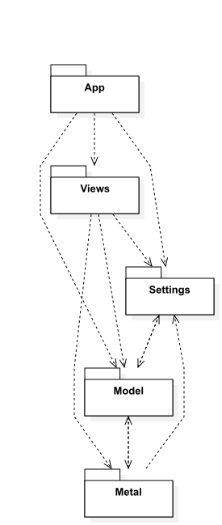
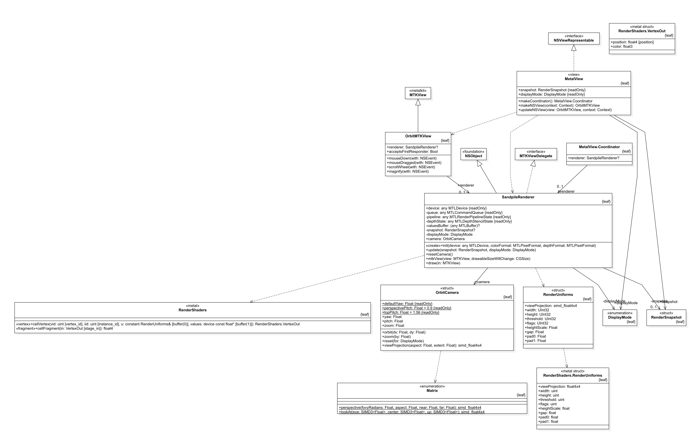
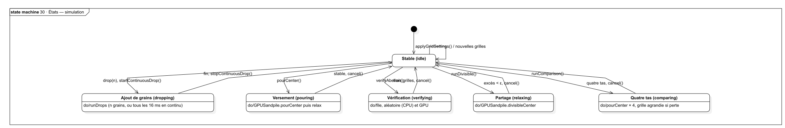
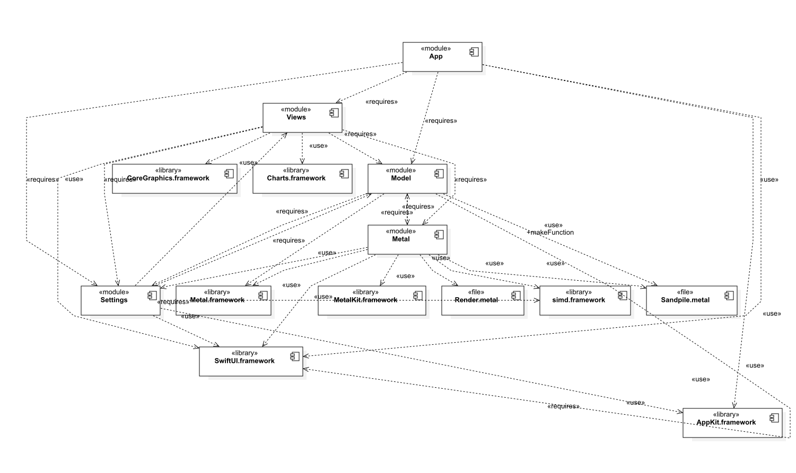
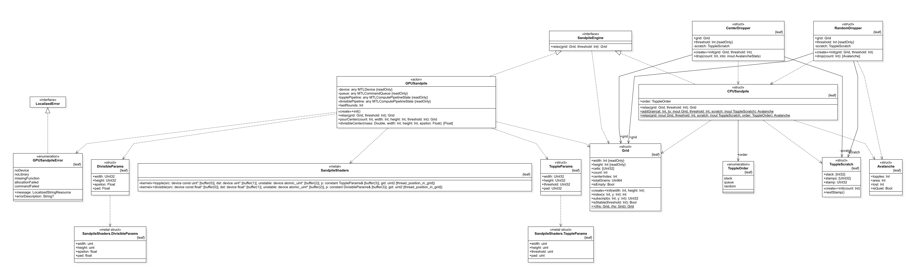
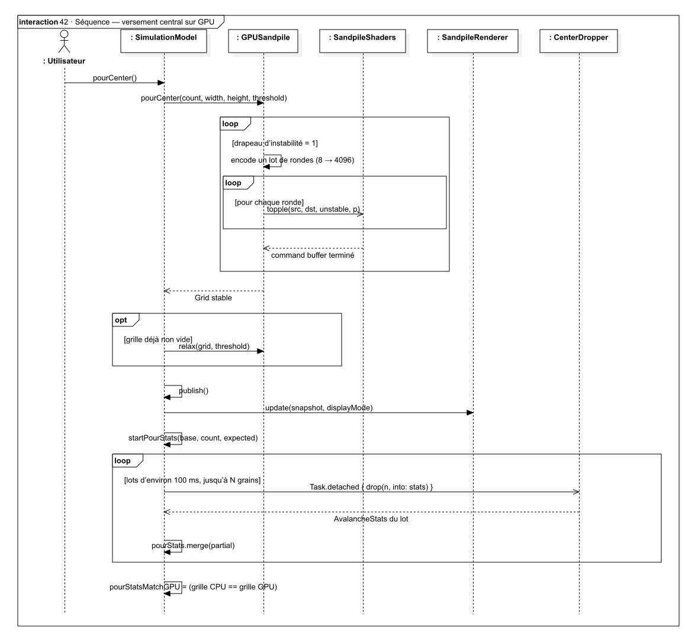

# Architecture de TasDeSable

Documentation technique du simulateur : organisation du code, algorithmes, calcul et rendu Metal,
concurrence Swift 6, réglages, tests et modèle UML. Pour l'usage et la compilation, voir le
[README](../README.md).

## Vue d'ensemble

```
             ┌──────────────────────── Application (SwiftUI) ────────────────────────┐
             │  TasDeSableApp ── WindowGroup ── ContentView ── panneaux, ComparisonView │
             │               └── Settings ──── SettingsView                            │
             └──────────────┬───────────────────────────────┬────────────────────────┘
                            │ @Environment                  │ @Environment
                     ┌──────▼──────┐  lit        ┌──────────▼──────────┐
                     │ AppSettings │◄────────────┤   SimulationModel   │  @MainActor @Observable
                     │ UserDefaults│             └──┬───────┬───────┬──┘
                     └─────────────┘                │       │       │ snapshot
                              RandomDropper ◄───────┘       │       ▼
                              CPUSandpile (CPU exact)       │   SimulationCanvas → MetalView
                                                            ▼            → SandpileRenderer
                                                 GPUSandpile (actor)        → Render.metal
                                                   → Sandpile.metal
```

| Paquet | Rôle | Fichiers |
|---|---|---|
| `App` | Point d'entrée : crée `AppSettings` et `SimulationModel` et les place dans l'environnement des deux scènes. | `TasDeSableApp.swift` |
| `Settings` | Réglages bornés et persistés, page de configuration. | `AppSettings.swift`, `SettingsView.swift` |
| `Model` | Grille, moteurs de bascule CPU et GPU, statistiques, état de la simulation. | `Grid.swift`, `CPUSandpile.swift`, `AvalancheStats.swift`, `GPUSandpile.swift`, `SimulationModel.swift` |
| `Metal` | Kernels de calcul, shaders de rendu, renderer, pont SwiftUI → MTKView, caméra. | `Sandpile.metal`, `Render.metal`, `SandpileRenderer.swift`, `MetalView.swift` |
| `Views` | Fenêtre principale, panneaux des quatre expériences, palette partagée avec le shader. | `ContentView.swift`, `*Panel.swift`, `ComparisonView.swift`, `Palette.swift` |



## Modèle de données

`Grid` est une `struct` `Sendable` : `width`, `height` et `cells: [UInt32]`, rangées ligne par ligne
(la case `(x, y)` est à l'indice `y * width + x`). L'opérateur `+` additionne deux grilles case par
case. `centerIndex` désigne la case centrale (arrondie vers le haut à gauche pour une taille paire).

Le protocole `SandpileEngine` (`relax(_:threshold:) async throws -> Grid`) est implémenté par les
deux moteurs. Il permet de comparer leurs résultats dans la vérification abélienne et dans les tests.

## Algorithmes

### Règle de bascule

Pour un seuil `T` (4 à 10), une case qui porte `h ≥ T` grains bascule : elle perd 4 grains et en
donne un à chacune de ses quatre voisines. Une voisine hors de la grille reçoit le grain, qui est
alors perdu. Une case qui doit basculer plusieurs fois le fait d'un coup :

```
k(h) = h ≥ T ? ⌊(h − T) / 4⌋ + 1 : 0        // nombre de bascules simultanées
h   ← h − 4k                                // h − 4k < T : la case est stable
```

Le minimum T = 4 garantit qu'une bascule ne crée pas de grains. La masse n'est perdue que par les
bords, donc toute cascade se termine. Le modèle est abélien : la grille finale ne dépend pas de
l'ordre des bascules (Dhar, 1990). C'est ce qui justifie les trois stratégies ci-dessous.

### CPU exact (`CPUSandpile`)

Les cases instables sont rangées dans un tableau `ToppleScratch.stack`. Une case n'y entre qu'au
moment où elle franchit le seuil (`avant < T ≤ après`), donc une seule fois. Trois ordres
(`ToppleOrder`) sont possibles :

| Ordre | Choix de la case suivante | Usage |
|---|---|---|
| `.queue` (défaut) | la plus ancienne (FIFO, avec un indice de tête) | relaxation d'un gros versement |
| `.stack` | la plus récente (LIFO) | une avalanche après un seul grain |
| `.random` | tirée au hasard | démonstration de l'abélianité |

L'ordre FIFO laisse les grains s'accumuler avant qu'une case bascule, si bien que k est grand. Mesuré
sur 10⁶ grains au centre d'une grille 64 × 64 : 0,06 s en file, 0,5 s en ordre aléatoire, 31 s en pile
(sans optimisation). C'est pourquoi `.queue` est l'ordre par défaut.

`addGrain(at:to:threshold:scratch:)` ajoute un grain et renvoie une `Avalanche` : `topples` (nombre
de bascules, base de l'histogramme), `area` (cases distinctes, comptées grâce à un tampon de marques
`stamps` incrémenté à chaque cascade, sans remise à zéro) et `lost` (grains perdus au bord).
`RandomDropper` enchaîne `count` ajouts en des cases tirées au hasard.

### Statistiques (`AvalancheStats`)

Pour chaque ajout, on compte les ajouts sans bascule (`quietFraction`), les records d'aire et de
bascules et les grains perdus. On tient aussi un histogramme logarithmique : la classe `b` compte les
avalanches de taille `s ∈ [2^b, 2^(b+1))`. `histogram` renvoie la fréquence par unité de taille
(nombre / 2^b / nombre d'ajouts), à la moyenne géométrique de la classe. Sur des axes log-log, la
loi de puissance de l'état critique donne une droite, coupée par la taille finie de la grille.

Le graphe (`AvalancheHistogram`, partagé par l'ajout aléatoire et le versement central) trace ces
fréquences en log-log. Les deux axes sont gradués en puissances de 10 (10⁰, 10¹… et 10⁻¹, 10⁻²…),
avec une ligne par décade. L'axe des x va jusqu'à la décade qui contient la plus grande avalanche,
celui des y couvre les décades des fréquences observées (`decades(from:to:)`). Au-delà de 8 décades,
seule une étiquette sur deux est affichée.

**Avalanches du versement central** : le GPU stabilise N grains d'un bloc, sans avalanches
individuelles. Pour l'histogramme, `SimulationModel` verse donc *aussi* les mêmes grains un par un
au centre, sur le CPU (`CenterDropper`) :
- le calcul tourne dans une tâche détachée de faible priorité, par lots d'environ 100 ms ;
- chaque lot renvoie ses `AvalancheStats`, fusionnées par `merge` et publiées au fur et à mesure,
  avec une barre de progression et un bouton d'arrêt ;
- le calcul est annulé par **Vider**, par un nouveau réglage de grille ou par un nouveau
  versement ; ce dernier poursuit la série si la précédente était complète ;
- à la fin, la grille obtenue grain par grain est comparée à celle du GPU. Elles doivent être
  identiques (propriété abélienne).

Le nombre total de bascules ne dépend pas de l'ordre. Il croît pourtant à peu près comme N², parce
qu'un grain versé tard traverse tout le tas. Sur 512 × 512, 10⁶ grains demandent environ une
minute, contre 1,3 s pour le GPU.

### GPU parallèle (`GPUSandpile`, kernel `topple`)

À chaque ronde, toutes les cases basculent en même temps, un fil par case :

```
h'(i) = h(i) − 4·k(h(i)) + Σ_{voisines j dans la grille} k(h(j))
```

- **Double tampon** : la ronde lit `src` et écrit `dst`, puis les deux tampons sont échangés.
  Les dispatchs d'un même encodeur de calcul s'exécutent en série, ce qui donne les dépendances
  entre rondes.
- **Drapeau d'instabilité** : un `atomic_uint` passe à 1 si une case écrite vaut encore `≥ T`. Seule
  la dernière ronde d'un lot écrit dans le vrai drapeau. Les autres écrivent dans un tampon ignoré,
  ce qui évite une barrière entre les rondes.
- **Lots croissants** : 8, 16, 32… jusqu'à 4096 rondes par command buffer. On attend la fin avec
  `addCompletedHandler` dans une `CheckedContinuation`, puis on lit le drapeau. Le calcul s'arrête
  quand il vaut 0.
- `pourCenter(count:width:height:threshold:)` pose tous les grains au centre et relaxe. Une
  stratégie par doublements (stab(2N) = stab(stab(N) + stab(N))) a été essayée : elle était plus
  lente (0,09 s contre 0,02 s pour 10⁶ grains sur 64 × 64, et 7,9 s contre 2,9 s sur 859 × 859).
- Pour verser des grains sur une grille qui en porte déjà, on calcule `relax(base + stab(N·δ))` :
  la propriété abélienne garantit que c'est la même chose que verser sur la grille existante.

### Tas divisible (kernel `divisible`)

La masse est réelle (`Float`). Une case dont la masse dépasse 1 garde 1 et partage l'excès
également entre ses quatre voisines, en parallèle (itération de Jacobi) :

```
m'(i) = min(m(i), 1) + Σ_j max(m(j) − 1, 0) / 4
```

On s'arrête quand plus aucune case ne dépasse `1 + ε` (ε = 10⁻³). L'ensemble des cases pleines
approche le disque d'aire N (Levine et Peres) : pour N = 1 000, on obtient 973 cases pleines, soit un
rayon équivalent de 17,60 pour 17,84 attendu.

### Quatre tas

`comparisonAmounts(for: N)` renvoie N, 10 N, 100 N et 1 000 N, ramenés à 2 000 000 grains au plus
pour le plus gros tas. `comparisonSide(for:threshold:)` estime le côté d'une grille assez grande avec
une densité moyenne de `T − 1,875` grains par case (2,125 pour T = 4) : `2,2·√(N / (densité·π)) + 8`.
Si des grains sont perdus (`totalGrains < N`), on recommence avec une grille 25 % plus grande. Les
tas sont ensuite affichés en images d'un pixel par case, toutes de la même taille.

## Rendu Metal

`MetalView` (`NSViewRepresentable`) crée une `OrbitMTKView` et un `SandpileRenderer`
(`MTKViewDelegate`, 60 images par seconde). À chaque mise à jour SwiftUI, elle transmet le
`RenderSnapshot` du modèle (`values: [Float]`, `kind`, `threshold`, `version`). Le renderer ne
recopie les valeurs dans son `MTLBuffer` partagé que si la version a changé.

`SimulationCanvas` est une vue distincte pour que SwiftUI suive `model.snapshot` dans son propre
`body`. Lu dans la fermeture `detail` de `NavigationSplitView`, il n'était pas suivi de façon fiable.

**Une image** : `drawPrimitives(.triangle, vertexCount: 36, instanceCount: largeur × hauteur)`.

- `cellVertex` tire le cube unité de tables constantes (6 faces × 4 coins, 2 triangles par face). Il
  place l'instance `iid` en `(iid % width, iid / width)`, centrée sur l'origine, avec une marge
  `gap` entre les colonnes (aucune au-delà de 256 cases).
- **Hauteur** : `0,08 + niveau × heightScale` en mode hauteur + couleur, `0,08` en couleur seule.
  Le niveau vaut `grains / (T − 1)`, ou la masse bornée à 1. `heightScale = clamp(côté × 0,08, 2, 40)`.
- **Couleur** : `ramp(palette, niveau)`, un dégradé entre les quatre couleurs de la palette choisie,
  passées en uniforme (`palette`, une `float4x4` dont chaque colonne est une couleur). La fonction
  est identique à `Palette.ramp` côté Swift (légende, images de comparaison et du tas divisible).
  Pour le tas divisible : la 4e couleur si la case est pleine, sinon un mélange de la 1re et de la
  2e selon la masse.
- **Couleur seule** : seule la face du dessus de chaque cube est dessinée (6 sommets au lieu de
  36). C'est plus rapide, et les faces latérales très plates ne se chevauchent plus.
- **Éclairage** : Lambert, `0,35 + 0,65·max(n·l, 0)`. Le test de profondeur `depth32Float` est en
  mode `.less`.

`OrbitCamera` (lacet, tangage, zoom) donne `projection × vue`, avec une perspective de 45° dont la
profondeur va de 0 à 1. En couleur seule, la vue par défaut est prise du dessus (tangage 1,56 rad).
Glisser fait tourner la caméra, la molette ou le pincement zoome, le double-clic réinitialise.

`RenderUniforms` (Swift) et `RenderUniforms` (MSL) ont la même disposition : 2 `float4x4` (vue
et projection, palette), puis 4 `uint`, puis 4 `float`, soit 160 octets. Il en va de même pour `ToppleParams` et `DivisibleParams`.



## Concurrence (Swift 6, vérification stricte)

| Type | Isolation | Raison |
|---|---|---|
| `SimulationModel`, `AppSettings` | `@MainActor @Observable` | état lu par SwiftUI |
| `SandpileRenderer`, `OrbitMTKView` | `@MainActor` | MetalKit, AppKit |
| `GPUSandpile` | `actor` | sérialise l'accès à la file de commandes et aux pipelines |
| `Grid`, `RandomDropper`, `CPUSandpile`, `RenderSnapshot`, rapports | `struct Sendable` | copiés d'un domaine à l'autre |

Chaque expérience s'exécute dans une `Task` du modèle (une seule à la fois, `state.isBusy`).
`cancel()` annule la tâche, et le moteur GPU vérifie `Task.checkCancellation()` entre deux lots. Les
ajouts de grains et les relaxations CPU de la vérification tournent dans `Task.detached` sur une
copie de la grille, que le modèle reprend sur le thread principal.



## Langue et palettes

**Langue** :
- `AppSettings.language` (`AppLanguage` : `fr`, `en`) est appliquée aux deux scènes par
  `.environment(\.locale, …)`. Toutes les vues SwiftUI (`Text`, `Button`, `Label`, `Picker`,
  graphiques) traduisent leurs clés et formatent leurs nombres dans cette langue, sans relancer
  l'application.
- Les nombres affichés passent par `Text(n, format: .number)` ou par une interpolation
  `\(n, format: .number)`, qui suivent `\.locale`. Les champs de saisie reçoivent
  `.number.locale(…)`.
- Ce qui n'est pas rendu par une vue est résolu avec `AppLanguage.localized(_:)`, un
  `LocalizedStringResource` dont la `locale` est fixée : le titre et le sous-titre de la fenêtre (la
  barre de titre ne suit pas `\.locale`) et les messages d'erreur (`GPUSandpileError.message`).
- Les textes sont dans `TasDeSable/Localizable.xcstrings`, avec le français comme langue source
  (les clés sont les textes français) et l'anglais comme traduction. Pour ajouter un texte, il suffit
  de l'écrire en français dans le code. Xcode l'ajoute au catalogue à la compilation, et il reste à
  le traduire. Les pluriels courts sont choisis dans le code (`cellsText`, `topplesText`).

**Palettes** :
- `CellPalette` propose `sand` (Sable : `#2B2722`, `#634731`, `#BB8665`, `#D1B58C`), `classic`
  (Classique : les couleurs d'origine) et `custom`.
- La palette Personnalisée a quatre couleurs `0xRRGGBB`, conservées dans `UserDefaults` et éditées
  par des `ColorPicker`.
- `AppSettings.paletteColors` donne les quatre couleurs en `SIMD3<Float>`. `SimulationCanvas` les
  passe à `MetalView`, et de là au renderer (uniforme `palette`), ainsi qu'à `Palette`, qui produit
  la légende et les images vues de dessus.

## Cycle de vie

L'application se termine quand sa dernière fenêtre est fermée. `AppDelegate`, branché par
`@NSApplicationDelegateAdaptor`, répond `true` à `applicationShouldTerminateAfterLastWindowClosed`.
Comme SwiftUI garde des fenêtres internes, il observe aussi `NSWindow.willCloseNotification` et
appelle `NSApp.terminate` quand il ne reste plus de fenêtre visible (principale ou réglages).

## Réglages

`AppSettings` lit un `SettingsStore` : `UserDefaults` dans l'application, `MemorySettingsStore`
dans les tests (un `UserDefaults(suiteName:)` retomberait sur les préférences de l'app hôte). Il lit
les clés `grid.width`, `grid.height`, `grid.threshold`,
`display.mode`, `pour.amount`) et borne chaque valeur à sa plage. `SettingsView` édite la taille et
le seuil dans un brouillon (`@State`). **Appliquer et réinitialiser** les enregistre puis appelle
`SimulationModel.applyGridSettings()`, qui recrée les grilles et remet les résultats à zéro. Une
confirmation est demandée si `hasContent`. La langue, l'affichage, la palette, les couleurs
personnalisées et le nombre de grains s'appliquent tout de suite (`onChange` → `save()`). Clés
`UserDefaults` supplémentaires : `app.language`, `display.palette`, `display.customColors`.

## Tests

`TasDeSableTests/SandpileTests.swift` (Swift Testing). Le paquet de tests est hébergé par
l'application, qui fournit la bibliothèque Metal par défaut.

| Suite | Tests |
|---|---|
| Tas abélien sur le CPU | bascule simple ; coin qui perd 2 grains ; conservation ajoutés = restants + perdus et stabilité ; plus de 50 % d'ajouts sans effet et avalanche de plus de 1 000 cases sur 64 × 64 ; file = pile = aléatoire (T = 4 et 7) |
| Tas sur le GPU | CPU = GPU pour 10⁴ et 10⁶ grains ; relaxation directe d'une grille quelconque ; seuil 7 ; tas divisible (masse conservée à ±1, cases ≤ 1,001, 900 à 1 000 cases pleines) ; grille de comparaison sans perte pour 10⁵ grains |
| Réglages | valeurs par défaut ; bornes et relecture ; quantités des quatre tas |

## Performances mesurées

Machine de développement Apple Silicon, compilation `-O` (activée aussi en Debug dans `project.yml`).

| Opération | Durée |
|---|---|
| 100 000 ajouts aléatoires, 64 × 64 (CPU) | 0,15 s |
| 10⁶ grains au centre, 64 × 64 (CPU, file) | 0,06 s |
| 10⁶ grains au centre, 64 × 64 (GPU) | 0,02 à 0,03 s |
| 10⁶ grains au centre, 859 × 859 (GPU, sans perte) | 2,7 à 2,9 s |
| 2 × 10⁶ grains au centre, 1 212 × 1 212 (GPU) | 10 s |
| Tas divisible, masse 1 000, 64 × 64 (GPU) | 0,02 s |

## Documentation UML

Le modèle StarUML [`uml/tasdesable.mdj`](uml/tasdesable.mdj) et les images de tous ses diagrammes
([`uml/images/`](uml/images/)) sont produits par l'outillage du skill `swift-staruml-docs`, installé
dans [`tools/staruml/`](tools/staruml/). **Tout ce qui est structurel est lu dans le code** par
[`tools/staruml/swift_source.py`](tools/staruml/swift_source.py) :

- les 42 types Swift : structs, classes, actors, enums, protocoles, types imbriqués comme
  `MetalView.Coordinator`, avec leurs membres, conformances, associations et dépendances. Leur
  documentation vient des commentaires `///` ;
- les **shaders Metal** : `Sandpile.metal` devient la classe «metal» `SandpileShaders`, avec ses
  kernels `topple` et `divisible`, et `Render.metal` devient `RenderShaders`, avec `cellVertex` et
  `cellFragment`. Leurs structs sont des classes imbriquées («metal struct»). `ToppleParams`,
  `DivisibleParams` et `RenderUniforms` côté Swift dépendent de la struct de shader qu'ils
  reflètent, et `GPUSandpile` et `SandpileRenderer` des shaders qu'ils chargent par nom ;
- les **composants**, un par paquet (App, Settings, Views, Model, Metal), et leurs dépendances. Ils
  utilisent les **frameworks** importés (`SwiftUI.framework`, `Metal.framework`,
  `MetalKit.framework`, `Charts.framework`…) et les fichiers `.metal`. L'interface `SandpileEngine`
  est fournie par Model.

Seuls les textes et ce qui ne se lit pas dans le code sont décrits à la main :
- dans [`tools/staruml/uml_config.py`](tools/staruml/uml_config.py) : les descriptions des paquets,
  les thèmes des diagrammes de classes et le déploiement ;
- dans [`tools/staruml/uml_scenarios.py`](tools/staruml/uml_scenarios.py) : les machines à états
  et les séquences.

| N° | Diagramme |
|---|---|
| 00 | [Vue d'ensemble](uml/images/00_Vue_d_ensemble.png) |
| 01 | [Paquets et dépendances](uml/images/01_Paquets_dependances.png) |
| 02 | [Composants : modules et dépendances](uml/images/02_Composants_modules_et_dependances.png) |
| 03 | [Composants : interfaces fournies et requises](uml/images/03_Composants_interfaces_fournies_et_requises.png) |
| 04 | [Déploiement : processus, GPU et préférences](uml/images/04_Deploiement_processus_GPU_et_preferences.png) |
| 10 | [Classes : réglages et application](uml/images/10_Classes_reglages_et_application.png) |
| 11 | [Classes : grille et moteurs de bascule](uml/images/11_Classes_grille_et_moteurs_de_bascule.png) |
| 12 | [Classes : état de la simulation](uml/images/12_Classes_etat_de_la_simulation.png) |
| 13 | [Classes : rendu Metal](uml/images/13_Classes_rendu_Metal.png) |
| 14 | [Classes : vues SwiftUI](uml/images/14_Classes_vues_SwiftUI.png) |
| 30 | [États : simulation](uml/images/30_Etats_simulation.png) |
| 31 | [États : case du tas](uml/images/31_Etats_case_du_tas.png) |
| 40 | [Séquence : lancement](uml/images/40_Sequence_lancement.png) |
| 41 | [Séquence : ajout d'un grain et avalanche](uml/images/41_Sequence_ajout_d_un_grain_et_avalanche.png) |
| 42 | [Séquence : versement central sur GPU](uml/images/42_Sequence_versement_central_sur_GPU.png) |
| 43 | [Séquence : vérification abélienne](uml/images/43_Sequence_verification_abelienne.png) |
| 44 | [Séquence : tas divisible](uml/images/44_Sequence_tas_divisible.png) |
| 45 | [Séquence : changement de réglages](uml/images/45_Sequence_changement_de_reglages.png) |
| 46 | [Séquence : rendu d'une image](uml/images/46_Sequence_rendu_d_une_image.png) |







Régénérer le modèle et les images après un changement du code, en conservant ce qui a été
arrangé à la main dans StarUML :

```bash
docs/tools/staruml/build.sh
```
